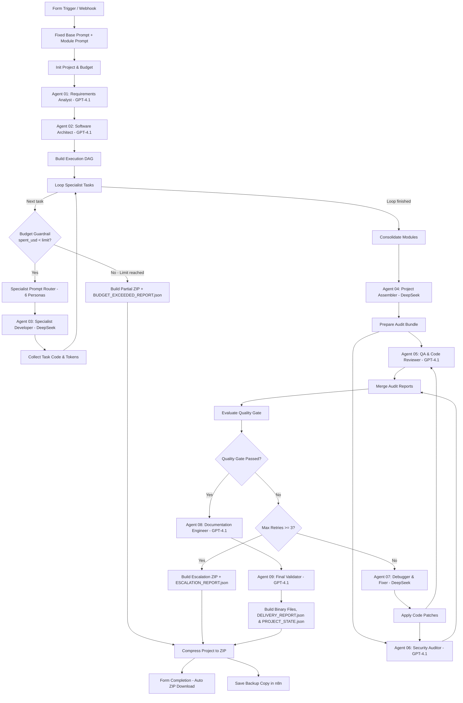
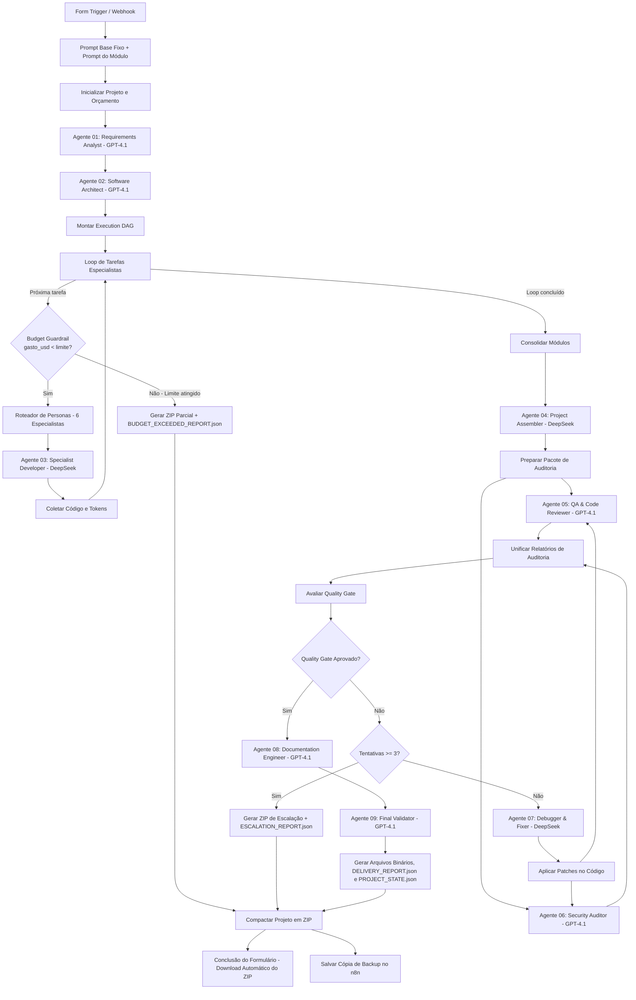

<a id="top"></a>

<div align="center">

# 🧪 Multi-Agent Software Factory — Data Science

### n8n · OpenAI (`gpt-4.1`) · DeepSeek (`deepseek-chat`) · FinOps Budget Guardrail

<a href="#english"><kbd>🇺🇸 English Version</kbd></a>&nbsp;&nbsp;
<a href="#portugues"><kbd>🇧🇷 Versão em Português</kbd></a>

<br/><br/>


<br/>

<kbd>🤖 9 AI Agents</kbd>&nbsp;
<kbd>🧩 34 n8n Nodes</kbd>&nbsp;
<kbd>🎭 6 Specialist Personas</kbd>&nbsp;
<kbd>💰 Real-Time FinOps Guardrail</kbd>&nbsp;
<kbd>🛡️ Showcase · Redacted Blueprint</kbd>

<br/><br/>


</div>

---

<a id="english"></a>

## 🇺🇸 English Documentation

> **Plan, build, audit, self-heal, document, and package Data Science & software modules incrementally — with real-time FinOps cost control.**

An incremental **multi-agent software factory** engineered in **n8n** that plans, develops, audits, self-heals, documents, and packages software modules — automatically delivering a downloadable `.zip` archive directly in the browser along with QA/Security audit reports, a non-technical user manual (`MANUAL_DE_UTILIZACAO.txt`), and a state snapshot (`PROJECT_STATE.json`) for seamless multi-module continuity.

<div align="center">

[Highlights](#en-highlights) · [Workflow Previews](#en-previews) · [Architecture](#en-architecture) · [9 Agents & Models](#en-agents) · [Blueprint Protection](#en-blueprint) · [Structure](#en-structure) · [License](#en-license)

</div>

> [!IMPORTANT]
> **Intellectual Property & Redacted Blueprint Notice:** This repository is published strictly as a **portfolio showcase**. The file `workflow/multi_agent_software_factory_blueprint.json` preserves the real **34-node topology and connections** for architectural inspection, but is **intentionally redacted and non-functional** — all proprietary system prompts, specialist personas, JavaScript orchestration code, FinOps pricing formulas, and API payloads have been removed. Reach out for a live walkthrough or licensing inquiries.

---

<a id="en-highlights"></a>

### ✨ Key Engineering & FinOps Highlights

<table>
  <tr>
    <td width="50%" valign="top">
      <h4>🧠 9 Specialized AI Agents & Hybrid LLM Routing</h4>
      <ul>
        <li>Strict JSON contracts (<code>response_format: json_object</code>) across all stages.</li>
        <li><strong><code>gpt-4.1</code></strong> handles high-stakes reasoning: requirements, architecture, QA review, AppSec auditing, documentation, and final validation.</li>
        <li><strong><code>deepseek-chat</code></strong> handles heavy code generation, project assembly, and surgical bug patching.</li>
      </ul>
    </td>
    <td width="50%" valign="top">
      <h4>🎭 Execution DAG & 6 Dynamic Specialist Personas</h4>
      <ul>
        <li>Decomposes each module into phase-ordered DAG tasks.</li>
        <li>Dynamically routes tasks across 6 personas: <code>Data Scientist</code>, <code>Data Engineer</code>, <code>ML Engineer</code>, <code>Automation Engineer</code>, <code>Web Scraping Engineer</code>, and <code>Full-Stack Engineer</code>.</li>
      </ul>
    </td>
  </tr>
  <tr>
    <td width="50%" valign="top">
      <h4>💰 Real-Time FinOps <code>Budget Guardrail</code></h4>
      <ul>
        <li>Calculates token usage and USD cost on every LLM call in real time.</li>
        <li>If spending reaches the configured USD cap, execution halts safely and exports a partial ZIP containing <code>BUDGET_EXCEEDED_REPORT.json</code>.</li>
      </ul>
    </td>
    <td width="50%" valign="top">
      <h4>🛡️ Parallel Quality Gate & Self-Healing Loop</h4>
      <ul>
        <li><code>QA &amp; Code Reviewer</code> and <code>Security Auditor</code> execute in parallel.</li>
        <li>Any <code>CRITICAL</code> or <code>HIGH</code> finding triggers <code>Debugger &amp; Fixer</code> for up to <strong>3 automated retry cycles</strong> before safe escalation (<code>ESCALATION_REPORT.json</code>).</li>
      </ul>
    </td>
  </tr>
  <tr>
    <td colspan="2" valign="top">
      <h4>📦 Stateful Incremental Delivery</h4>
      <ul>
        <li>Exports <code>PROJECT_STATE.json</code> (stack, directory tree, DB schema, API contracts, existing files), <code>DELIVERY_REPORT.json</code>, and a beginner-friendly <code>MANUAL_DE_UTILIZACAO.txt</code> so subsequent modules evolve seamlessly on top of approved deliverables.</li>
      </ul>
    </td>
  </tr>
</table>

---

<a id="en-previews"></a>

### 🖼️ Workflow Canvas Previews (Real n8n Execution Graph)

#### Part 1 — Intake (Form Trigger), Planning, Execution DAG & FinOps Budget Guardrail

<p align="center">
  
</p>

#### Part 2 — Module Consolidation, Parallel QA/Security Audit, Self-Healing & Auto ZIP Delivery

<p align="center">
  
</p>

---

<a id="en-architecture"></a>

### 🏗️ System Architecture

<p align="center">
  
</p>

<details>
<summary><strong>📐 View Interactive Mermaid Flowchart (Click to expand)</strong></summary>
<br/>



</details>

---

<a id="en-agents"></a>

### 🧠 The 9 AI Agents & Hybrid Model Allocation

| # | Agent | Model | Core Responsibility |
|---|---|---|---|
| **01** | **Requirements Analyst** | `gpt-4.1` | Converts the module specification into strict JSON functional/non-functional requirements, scope classification, and testable acceptance criteria. |
| **02** | **Software Architect** | `gpt-4.1` | Designs stack, directory structure, data schema, API contracts, and decomposes the module into phase-ordered DAG tasks. |
| **03** | **Specialist Developer** | `deepseek-chat` | Executes each DAG task using one of 6 specialist personas and returns complete modular deliverables. |
| **04** | **Project Assembler** | `deepseek-chat` | Consolidates deliverables, enforces package/import consistency, and generates configuration files when applicable. |
| **05** | **QA & Code Reviewer** | `gpt-4.1` | Reviews syntax, imports, architecture compliance, type hints, structured logging, exception handling, and `pytest` unit test coverage. |
| **06** | **Security Auditor** | `gpt-4.1` | Runs AppSec checks (hardcoded secrets, SQL/command injection, path traversal, SSRF) and verifies ethical access-policy compliance. |
| **07** | **Debugger & Fixer** | `deepseek-chat` | Performs root-cause analysis on blocking (`CRITICAL`/`HIGH`) QA/Security findings and generates surgical code patches for re-auditing. |
| **08** | **Documentation Engineer** | `gpt-4.1` | Generates/updates `README.md`, `docs/ARCHITECTURE.md`, `CHANGELOG.md`, and a beginner-friendly `MANUAL_DE_UTILIZACAO.txt`. |
| **09** | **Final Validator** | `gpt-4.1` | Audits every acceptance criterion and emits the final `DELIVERY_REPORT.json` checklist and next steps. |

---

<a id="en-blueprint"></a>

### 🔒 What Is Protected in the Blueprint (`workflow/`)

> [!NOTE]
> Designed to showcase real engineering architecture and FinOps guardrails without exposing copy-pasteable proprietary logic.

<table>
  <tr>
    <td width="50%" valign="top">
      <h4>✅ Preserved for Architectural Inspection</h4>
      <ul>
        <li>All <strong>34 real nodes</strong> and connection graphs.</li>
        <li>Full visual topology of intake, DAG loop, FinOps guardrail, parallel QA/AppSec audit, self-healing retries, and ZIP export.</li>
      </ul>
    </td>
    <td width="50%" valign="top">
      <h4>🔐 Redacted & Non-Functional</h4>
      <ul>
        <li>All <strong>system prompts, 6 specialist personas, JSON payloads, API URLs, and credentials</strong> replaced with non-functional placeholders.</li>
        <li>All <strong>12 JavaScript orchestration nodes</strong> replaced with commented stubs that throw an error if executed.</li>
        <li>Files in <code>examples/</code> use generic illustrative data solely to demonstrate output contracts.</li>
      </ul>
    </td>
  </tr>
</table>

---

<a id="en-structure"></a>

### 📁 Repository Structure

<details>
<summary><strong>Click to expand directory tree</strong></summary>
<br/>

```text
n8n-multi-agent-software-factory-data-science/
├── README.md
├── LICENSE                                                # All Rights Reserved (Portfolio Showcase)
├── .gitignore
├── workflow/
│   └── multi_agent_software_factory_blueprint.json        # Redacted, non-functional architectural blueprint (34 nodes)
├── assets/
│   ├── workflow_part1_intake_planning.png                 # Real n8n canvas screenshot (Part 1)
│   ├── workflow_part2_audit_delivery.png                  # Real n8n canvas screenshot (Part 2)
│   └── architecture_diagram.png                           # High-resolution system architecture diagram
└── examples/
    ├── sample_DELIVERY_REPORT.json                        # Illustrative final delivery report structure
    └── sample_PROJECT_STATE.json                          # Illustrative state file for incremental continuity
```

</details>

---

<a id="en-license"></a>

### 📄 License

**All Rights Reserved** — see [`LICENSE`](LICENSE) for intellectual property terms.

<div align="center">

<br/>

[⬆️ Back to top](#top) · [🇧🇷 Ir para a versão em Português](#portugues)

</div>

---

<a id="portugues"></a>

## 🇧🇷 Documentação em Português

> **Planeje, desenvolva, audite, corrija, documente e empacote módulos de Ciência de Dados e software de forma incremental — com controle de custos FinOps em tempo real.**

**Fábrica de software multiagente incremental** construída no **n8n** para planejar, desenvolver, auditar, corrigir, documentar e empacotar módulos de software — entregando um arquivo `.zip` pronto para download direto no navegador, acompanhado de relatórios de QA/Segurança, manual para usuários leigos (`MANUAL_DE_UTILIZACAO.txt`) e snapshot de memória (`PROJECT_STATE.json`) para continuidade entre módulos.

<div align="center">

[Diferenciais](#pt-highlights) · [Capturas do Workflow](#pt-previews) · [Arquitetura](#pt-architecture) · [9 Agentes & Modelos](#pt-agents) · [Proteção do Blueprint](#pt-blueprint) · [Estrutura](#pt-structure) · [Licença](#pt-license)

</div>

> [!IMPORTANT]
> **Aviso de Propriedade Intelectual (Blueprint Não Funcional):** Este repositório é uma **vitrine de portfólio**. O arquivo `workflow/multi_agent_software_factory_blueprint.json` preserva a topologia real dos **34 nós e suas conexões** para inspeção arquitetural, mas está **propositalmente ocultado (redacted) e não executável** — todos os prompts proprietários, personas especialistas, scripts JavaScript de orquestração, fórmulas de FinOps e endpoints foram removidos para proteger a propriedade intelectual do projeto. Entre em contato para demonstração ao vivo ou licenciamento.

---

<a id="pt-highlights"></a>

### ✨ Diferenciais de Engenharia e FinOps

<table>
  <tr>
    <td width="50%" valign="top">
      <h4>🧠 9 Agentes Especializados & Roteamento Híbrido</h4>
      <ul>
        <li>Papéis isolados com saída em JSON estrito (<code>response_format: json_object</code>).</li>
        <li><strong><code>gpt-4.1</code></strong> conduz etapas críticas: planejamento, arquitetura, revisão de código, auditoria AppSec, documentação e validação final.</li>
        <li><strong><code>deepseek-chat</code></strong> executa geração pesada de código, montagem de projeto e correções cirúrgicas.</li>
      </ul>
    </td>
    <td width="50%" valign="top">
      <h4>🎭 Execution DAG & 6 Personas Técnicas</h4>
      <ul>
        <li>O Arquiteto quebra o módulo em tarefas ordenadas por fase (DAG).</li>
        <li>Cada tarefa é despachada dinamicamente para uma de 6 personas: <code>Data Scientist</code>, <code>Data Engineer</code>, <code>ML Engineer</code>, <code>Automation Engineer</code>, <code>Web Scraping Engineer</code> e <code>Full-Stack Engineer</code>.</li>
      </ul>
    </td>
  </tr>
  <tr>
    <td width="50%" valign="top">
      <h4>💰 FinOps com <code>Budget Guardrail</code> em Tempo Real</h4>
      <ul>
        <li>Calcula o gasto em USD em tempo real com base nos tokens retornados pelas APIs.</li>
        <li>Ao atingir o orçamento limite informado no formulário, interrompe novas chamadas com segurança e gera um ZIP parcial com <code>BUDGET_EXCEEDED_REPORT.json</code>.</li>
      </ul>
    </td>
    <td width="50%" valign="top">
      <h4>🛡️ Quality Gate Paralelo com Self-Healing</h4>
      <ul>
        <li><code>QA &amp; Code Reviewer</code> e <code>Security Auditor</code> rodam simultaneamente.</li>
        <li>Falhas <code>CRITICAL</code> ou <code>HIGH</code> acionam o <code>Debugger &amp; Fixer</code> por até <strong>3 ciclos automáticos</strong>; persistindo falhas, escala com <code>ESCALATION_REPORT.json</code>.</li>
      </ul>
    </td>
  </tr>
  <tr>
    <td colspan="2" valign="top">
      <h4>📦 Desenvolvimento Incremental com Memória de Estado</h4>
      <ul>
        <li>Gera <code>PROJECT_STATE.json</code> (stack, diretórios, schema de banco, contratos de API e arquivos existentes), <code>DELIVERY_REPORT.json</code> e <code>MANUAL_DE_UTILIZACAO.txt</code> para que os próximos módulos evoluam sem sobrescrever entregas já aprovadas.</li>
      </ul>
    </td>
  </tr>
</table>

---

<a id="pt-previews"></a>

### 🖼️ Visualização do Workflow no n8n (Capturas Reais)

#### Parte 1 — Entrada (Form Trigger), Planejamento, Execution DAG e Budget Guardrail

<p align="center">
  
</p>

#### Parte 2 — Consolidação, Auditoria Paralela (QA + Segurança), Self-Healing e Download ZIP

<p align="center">
  
</p>

---

<a id="pt-architecture"></a>

### 🏗️ Arquitetura do Sistema

<p align="center">
  
</p>

<details>
<summary><strong>📐 Ver Fluxograma Interativo Mermaid (Clique para expandir)</strong></summary>
<br/>



</details>

---

<a id="pt-agents"></a>

### 🧠 Os 9 Agentes e Modelos Utilizados

| # | Agente | Modelo | Responsabilidade Principal |
|---|---|---|---|
| **01** | **Requirements Analyst** | `gpt-4.1` | Converte a especificação do módulo em requisitos funcionais/não-funcionais, classificação de escopo e critérios de aceitação testáveis. |
| **02** | **Software Architect** | `gpt-4.1` | Define stack, estrutura de diretórios, modelo de dados, contratos de API e divide o módulo em tarefas ordenadas por fase (DAG). |
| **03** | **Specialist Developer** | `deepseek-chat` | Executa cada tarefa do DAG assumindo dinamicamente uma das 6 personas especialistas e devolve arquivos completos em JSON. |
| **04** | **Project Assembler** | `deepseek-chat` | Consolida os arquivos, valida imports/pacotes e gera arquivos de configuração quando necessário. |
| **05** | **QA & Code Reviewer** | `gpt-4.1` | Audita sintaxe, imports, aderência arquitetural, type hints, logging estruturado, tratamento de exceções e testes unitários em `pytest`. |
| **06** | **Security Auditor** | `gpt-4.1` | Executa auditoria AppSec (credenciais hardcoded, SQL/command injection, path traversal, SSRF) e verifica conformidade com regras éticas de acesso. |
| **07** | **Debugger & Fixer** | `deepseek-chat` | Identifica a causa-raiz de apontamentos bloqueantes (`CRITICAL`/`HIGH`) e aplica patches cirúrgicos para nova rodada de auditoria. |
| **08** | **Documentation Engineer** | `gpt-4.1` | Gera e consolida `README.md`, `docs/ARCHITECTURE.md`, `CHANGELOG.md` e `MANUAL_DE_UTILIZACAO.txt` em linguagem simples para usuários leigos. |
| **09** | **Final Validator** | `gpt-4.1` | Valida o checklist final de critérios de aceitação, limitações conhecidas e próximos passos em `DELIVERY_REPORT.json`. |

---

<a id="pt-blueprint"></a>

### 🔒 O que está protegido no Blueprint (`workflow/`)

> [!NOTE]
> Estruturado para demonstrar a engenharia e os controles FinOps do projeto sem expor propriedade intelectual pronta para cópia.

<table>
  <tr>
    <td width="50%" valign="top">
      <h4>✅ Preservado para Inspeção Arquitetural</h4>
      <ul>
        <li>Todos os <strong>34 nós e conexões reais</strong> do workflow.</li>
        <li>Topologia visual completa da entrada, loop DAG, guardrail FinOps, auditoria paralela QA/AppSec, self-healing e exportação ZIP.</li>
      </ul>
    </td>
    <td width="50%" valign="top">
      <h4>🔐 Ocultado e Não Executável</h4>
      <ul>
        <li>Todos os <strong>prompts de sistema, 6 personas, payloads JSON, URLs de API e credenciais</strong> substituídos por placeholders não funcionais.</li>
        <li>Todos os <strong>12 nós de código JavaScript</strong> substituídos por stubs comentados que lançam erro caso executados.</li>
        <li>Arquivos em <code>examples/</code> usam dados ilustrativos genéricos apenas para demonstrar o contrato de saída.</li>
      </ul>
    </td>
  </tr>
</table>

---

<a id="pt-structure"></a>

### 📁 Estrutura do Repositório

<details>
<summary><strong>Clique para expandir a árvore de diretórios</strong></summary>
<br/>

```text
n8n-multi-agent-software-factory-data-science/
├── README.md
├── LICENSE                                                # Todos os direitos reservados (Vitrine de Portfólio)
├── .gitignore
├── workflow/
│   └── multi_agent_software_factory_blueprint.json        # Blueprint arquitetural protegido e não executável (34 nós)
├── assets/
│   ├── workflow_part1_intake_planning.png                 # Captura real do canvas no n8n (Parte 1)
│   ├── workflow_part2_audit_delivery.png                  # Captura real do canvas no n8n (Parte 2)
│   └── architecture_diagram.png                           # Diagrama de arquitetura em alta resolução
└── examples/
    ├── sample_DELIVERY_REPORT.json                        # Estrutura ilustrativa do relatório final de entrega
    └── sample_PROJECT_STATE.json                          # Arquivo ilustrativo de estado para continuidade incremental
```

</details>

---

<a id="pt-license"></a>

### 📄 Licença

**All Rights Reserved (Todos os Direitos Reservados)** — consulte [`LICENSE`](LICENSE) para os termos de propriedade intelectual.

<div align="center">

<br/>

[⬆️ Voltar ao topo](#top) · [🇺🇸 Switch to English](#english)

</div>