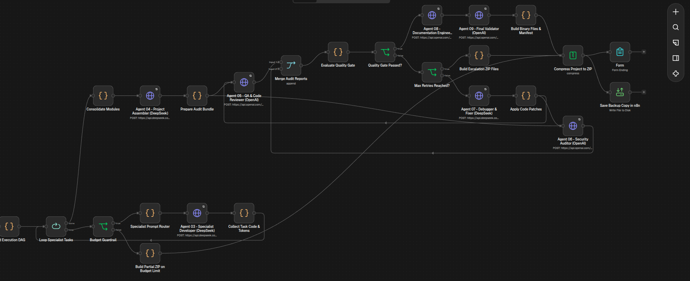
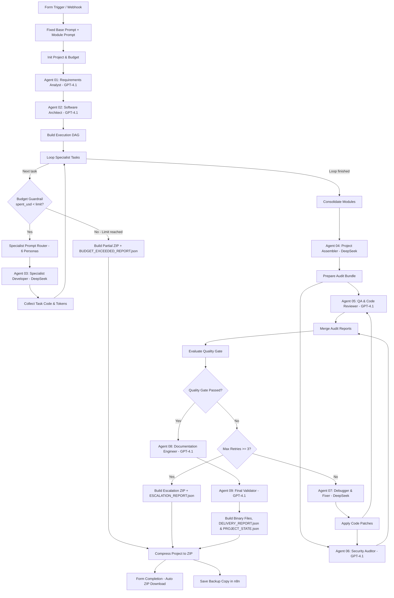

<div align="center">

# Multi-Agent Software Factory (n8n + OpenAI + DeepSeek)


**Language / Idioma:** [English](#english) | [Português (Brasil)](#portugues)

</div>

---

<a id="english"></a>

## English

### Overview

An incremental, multi-agent software factory engineered in **n8n** that plans, develops, audits, self-heals, documents, and packages software modules — automatically delivering a downloadable `.zip` archive directly in the browser along with QA/Security audit reports, a non-technical user manual (`MANUAL_DE_UTILIZACAO.txt`), and a state snapshot (`PROJECT_STATE.json`) for multi-module continuity.

> **Intellectual Property & Blueprint Notice:** This repository is a **portfolio showcase**. The file `workflow/multi_agent_software_factory_blueprint.json` preserves the real 34-node topology and connections for architectural inspection, but is **intentionally redacted and non-functional** — all proprietary system prompts, specialist personas, JavaScript orchestration code, FinOps pricing formulas, and API payloads have been removed. Reach out if you would like a live walkthrough or licensing information.

### Workflow Canvas Preview

#### Part 1 — Intake, Planning, Execution DAG & FinOps Budget Guardrail
<p align="center">
  
</p>

#### Part 2 — Module Consolidation, Parallel QA/Security Audit, Self-Healing & Auto ZIP Delivery
<p align="center">
  
</p>

### Key Engineering & FinOps Highlights

- **9 Specialized AI Agents** orchestrated with strict JSON contracts (`response_format: json_object`).
- **Hybrid LLM Routing (Cost vs. Reasoning):** assigns `gpt-4.1` to high-stakes reasoning stages (requirements, architecture, code review, AppSec auditing, documentation, and final validation) while delegating code generation, assembly, and bug fixing to `deepseek-chat`.
- **Execution DAG & Dynamic Persona Routing:** decomposes each module into phase-ordered tasks and dynamically routes them across **6 specialist personas** (`Data Scientist`, `Data Engineer`, `ML Engineer`, `Automation Engineer`, `Web Scraping Engineer`, and `Full-Stack Engineer`).
- **Real-Time FinOps `Budget Guardrail`:** calculates token usage and USD cost on every LLM call. If spending exceeds the configured USD cap, execution stops safely and exports a partial ZIP containing `BUDGET_EXCEEDED_REPORT.json`.
- **Parallel Quality Gate & Self-Healing Loop:** `QA & Code Reviewer` and `Security Auditor` execute in parallel. Any `CRITICAL` or `HIGH` finding triggers `Debugger & Fixer` for up to **3 automated retry cycles**; if unresolved, the workflow escalates safely with an `ESCALATION_REPORT.json`.
- **Stateful Incremental Development:** outputs `PROJECT_STATE.json` (stack, directory tree, DB schema, API contracts, existing files) so subsequent modules build seamlessly on top of approved deliverables.

### System Architecture

<p align="center">
  
</p>

<details>
<summary><strong>View Mermaid Flowchart (Click to expand)</strong></summary>



</details>

### The 9 Agents & Hybrid Model Allocation

| # | Agent | Model | Core Responsibility |
|---|---|---|---|
| 01 | **Requirements Analyst** | `gpt-4.1` | Converts the module specification into strict JSON functional/non-functional requirements, scope classification, and testable acceptance criteria. |
| 02 | **Software Architect** | `gpt-4.1` | Designs stack, directory structure, data schema, API contracts, and decomposes the module into phase-ordered DAG tasks. |
| 03 | **Specialist Developer** | `deepseek-chat` | Executes each DAG task using one of 6 specialist personas and returns complete modular deliverables. |
| 04 | **Project Assembler** | `deepseek-chat` | Consolidates deliverables, enforces package/import consistency, and generates configuration files when applicable. |
| 05 | **QA & Code Reviewer** | `gpt-4.1` | Reviews syntax, imports, architecture compliance, type hints, structured logging, exception handling, and `pytest` unit test coverage. |
| 06 | **Security Auditor** | `gpt-4.1` | Runs AppSec checks (hardcoded secrets, SQL/command injection, path traversal, SSRF) and verifies ethical access-policy compliance. |
| 07 | **Debugger & Fixer** | `deepseek-chat` | Performs root-cause analysis on blocking (`CRITICAL`/`HIGH`) QA/Security findings and generates surgical code patches for re-auditing. |
| 08 | **Documentation Engineer** | `gpt-4.1` | Generates/updates `README.md`, `docs/ARCHITECTURE.md`, `CHANGELOG.md`, and a beginner-friendly `MANUAL_DE_UTILIZACAO.txt`. |
| 09 | **Final Validator** | `gpt-4.1` | Audits every acceptance criterion and emits the final `DELIVERY_REPORT.json` checklist and next steps. |

### Repository Structure

```text
n8n-multi-agent-software-factory/
├── README.md
├── LICENSE                                                # All Rights Reserved (Portfolio Showcase)
├── .gitignore
├── workflow/
│   └── multi_agent_software_factory_blueprint.json        # Redacted, non-functional architectural blueprint (34 nodes)
├── assets/
│   ├── workflow_part1_intake_planning.png                 # Real n8n canvas screenshot (Part 1)
│   ├── workflow_part2_audit_delivery.png                  # Real n8n canvas screenshot (Part 2)
│   └── architecture_diagram.png                           # High-resolution system architecture diagram
└── examples/
    ├── sample_DELIVERY_REPORT.json                        # Illustrative final delivery report structure
    └── sample_PROJECT_STATE.json                          # Illustrative state file for incremental continuity
```

---

<a id="portugues"></a>

## Português (Brasil)

### Visão Geral

Fábrica de software multiagente construída no **n8n** para planejar, desenvolver, auditar, corrigir, documentar e empacotar módulos de software de forma incremental — entregando um arquivo `.zip` pronto para download direto no navegador, acompanhado de relatórios de QA/Segurança, manual para usuários leigos (`MANUAL_DE_UTILIZACAO.txt`) e snapshot de memória (`PROJECT_STATE.json`) para continuidade entre módulos.

> **Aviso de Propriedade Intelectual (Blueprint Não Funcional):** Este repositório é uma **vitrine de portfólio**. O arquivo `workflow/multi_agent_software_factory_blueprint.json` preserva a topologia real dos 34 nós e suas conexões para inspeção arquitetural, mas está **propositalmente ocultado (redacted) e não executável** — todos os prompts proprietários, personas especialistas, scripts JavaScript de orquestração, fórmulas de FinOps e endpoints foram removidos para proteger a propriedade intelectual do projeto. Entre em contato para demonstração ao vivo ou licenciamento.

### Visualização do Workflow no n8n

#### Parte 1 — Entrada (Form Trigger), Planejamento, Execution DAG e Budget Guardrail
<p align="center">
  
</p>

#### Parte 2 — Consolidação, Auditoria Paralela (QA + Segurança), Self-Healing e Download ZIP
<p align="center">
  
</p>

### Diferenciais de Engenharia e FinOps

- **9 agentes especializados** com papéis isolados e saída em JSON estrito (`response_format: json_object`).
- **Roteamento híbrido de LLMs (custo vs. raciocínio):** usa `gpt-4.1` nas etapas críticas de planejamento, arquitetura, revisão de código, auditoria de segurança, documentação e validação final, enquanto delega geração pesada de código, montagem e correções para o `deepseek-chat`.
- **Execution DAG + Roteamento de Personas:** o Arquiteto quebra o módulo em tarefas ordenadas por fase e despacha cada tarefa para uma entre **6 personas técnicas** (`Data Scientist`, `Data Engineer`, `ML Engineer`, `Automation Engineer`, `Web Scraping Engineer` e `Full-Stack Engineer`).
- **FinOps com `Budget Guardrail`:** calcula o gasto em USD em tempo real com base nos tokens retornados pelas APIs. Ao atingir o orçamento limite informado no formulário, o fluxo interrompe novas chamadas com segurança e gera um ZIP parcial com `BUDGET_EXCEEDED_REPORT.json`.
- **Quality Gate paralelo com Self-Healing:** `QA & Code Reviewer` e `Security Auditor` rodam simultaneamente. Falhas `CRITICAL` ou `HIGH` acionam o `Debugger & Fixer` automaticamente por até **3 ciclos**; atingido o limite, o fluxo escala para revisão humana com um `ESCALATION_REPORT.json`.
- **Desenvolvimento incremental com memória de estado:** gera `PROJECT_STATE.json` (stack, diretórios, schema de banco, contratos de API e arquivos existentes) para que os próximos módulos evoluam o projeto sem sobrescrever entregas já aprovadas.

### Arquitetura do Sistema

<p align="center">
  
</p>

### Os 9 Agentes e Modelos Utilizados

| # | Agente | Modelo | Responsabilidade Principal |
|---|---|---|---|
| 01 | **Requirements Analyst** | `gpt-4.1` | Converte a especificação do módulo em requisitos funcionais/não-funcionais, classificação de escopo e critérios de aceitação testáveis. |
| 02 | **Software Architect** | `gpt-4.1` | Define stack, estrutura de diretórios, modelo de dados, contratos de API e divide o módulo em tarefas ordenadas por fase (DAG). |
| 03 | **Specialist Developer** | `deepseek-chat` | Executa cada tarefa do DAG assumindo dinamicamente uma das 6 personas especialistas e devolve arquivos completos em JSON. |
| 04 | **Project Assembler** | `deepseek-chat` | Consolida os arquivos, valida imports/pacotes e gera arquivos de configuração quando necessário. |
| 05 | **QA & Code Reviewer** | `gpt-4.1` | Audita sintaxe, imports, aderência arquitetural, type hints, logging estruturado, tratamento de exceções e testes unitários em `pytest`. |
| 06 | **Security Auditor** | `gpt-4.1` | Executa auditoria AppSec (credenciais hardcoded, SQL/command injection, path traversal, SSRF) e verifica conformidade com regras éticas de acesso. |
| 07 | **Debugger & Fixer** | `deepseek-chat` | Identifica a causa-raiz de apontamentos bloqueantes (`CRITICAL`/`HIGH`) e aplica patches cirúrgicos para nova rodada de auditoria. |
| 08 | **Documentation Engineer** | `gpt-4.1` | Gera e consolida `README.md`, `docs/ARCHITECTURE.md`, `CHANGELOG.md` e `MANUAL_DE_UTILIZACAO.txt` em linguagem simples para usuários leigos. |
| 09 | **Final Validator** | `gpt-4.1` | Valida o checklist final de critérios de aceitação, limitações conhecidas e próximos passos em `DELIVERY_REPORT.json`. |

### O que está protegido no Blueprint (`workflow/`)

Para demonstrar a engenharia do projeto sem expor propriedade intelectual pronta para cópia:
- Todos os **34 nós e conexões reais** estão preservados para visualização estrutural.
- Todos os **prompts de sistema, personas, payloads JSON, URLs de API e credenciais** foram substituídos por placeholders não funcionais.
- Todos os **12 nós de código JavaScript** foram substituídos por stubs comentados que lançam erro caso executados.
- Os arquivos em `examples/` utilizam dados ilustrativos genéricos apenas para demonstrar o contrato de saída.

---

## License / Licença

All Rights Reserved — see [`LICENSE`](LICENSE) for intellectual property terms.
