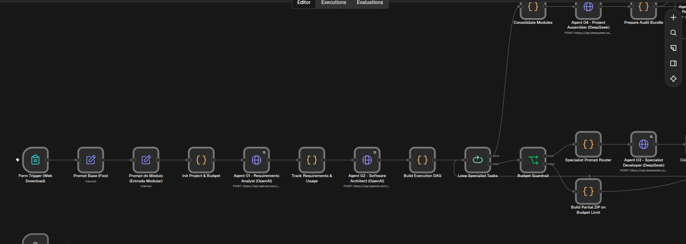
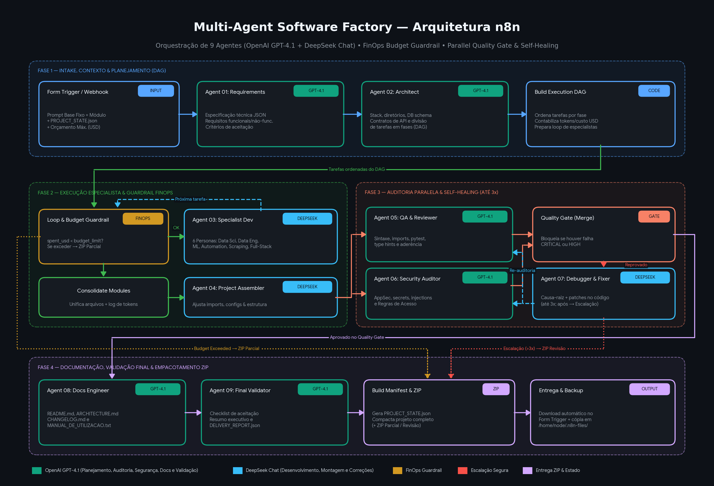
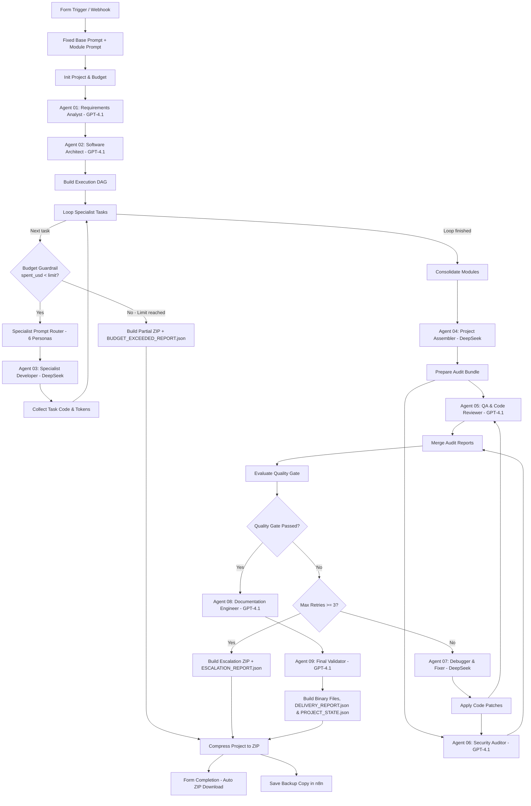

<div align="center">

# Multi-Agent Software Factory (n8n + OpenAI + DeepSeek)


**Language / Idioma:** [English](#english) | [Português (Brasil)](#portugues)

</div>

---

<a id="english"></a>

## English

### Overview

An incremental, multi-agent software factory built in **n8n** that plans, develops, audits, self-heals, documents, and packages software modules — automatically delivering a downloadable `.zip` archive directly in the browser along with QA/Security reports, a beginner-friendly user manual (`MANUAL_DE_UTILIZACAO.txt`), and a state snapshot (`PROJECT_STATE.json`) for multi-module continuity.

### Workflow Canvas Preview

#### Part 1 — Intake, Planning, Execution DAG & FinOps Budget Guardrail
<p align="center">
  
</p>

#### Part 2 — Module Consolidation, Parallel QA/Security Audit, Self-Healing & Auto ZIP Delivery
<p align="center">
  
</p>

### Key Engineering & FinOps Highlights

- **9 Specialized AI Agents** with strict structured JSON contracts (`response_format: json_object`).
- **Hybrid LLM Routing (Cost vs. Reasoning):** assigns `gpt-4.1` to high-stakes reasoning stages (requirements, architecture, QA review, AppSec auditing, documentation, and final validation) while delegating code generation, assembly, and bug fixing to `deepseek-chat`.
- **Execution DAG & Dynamic Persona Routing:** splits each module into phase-ordered tasks and dynamically routes them across **6 specialist personas** (`data_scientist`, `data_engineer`, `ml_engineer`, `automation_engineer`, `scraping_engineer`, `backend_frontend_engineer`).
- **Real-Time FinOps `Budget Guardrail`:** tracks token usage and USD cost on every LLM call. If spending exceeds the configured USD cap, execution stops safely and exports a partial ZIP containing `BUDGET_EXCEEDED_REPORT.json`.
- **Parallel Quality Gate & Self-Healing Loop:** `QA & Code Reviewer` and `Security Auditor` run in parallel. Any `CRITICAL` or `HIGH` finding triggers `Debugger & Fixer` for up to **3 automated retry cycles**; if unresolved, the workflow escalates safely with an `ESCALATION_REPORT.json`.
- **Stateful Incremental Development:** outputs `PROJECT_STATE.json` (stack, directory tree, DB schema, API contracts, existing files) so subsequent modules build seamlessly on top of approved deliverables.

### System Architecture

<p align="center">
  
</p>

<details>
<summary><strong>View Mermaid Flowchart (Click to expand)</strong></summary>



</details>

### The 9 Agents & Hybrid Model Allocation

| # | Agent | Model | Core Responsibility |
|---|---|---|---|
| 01 | **Requirements Analyst** | `gpt-4.1` | Converts the module specification into strict JSON functional/non-functional requirements, scope (`PLANNING_DOCS`, `IMPLEMENTATION`, `HYBRID`), and testable acceptance criteria. |
| 02 | **Software Architect** | `gpt-4.1` | Designs stack, directory structure, DB schema, API contracts, and decomposes the module into phase-ordered DAG tasks. |
| 03 | **Specialist Developer** | `deepseek-chat` | Executes each DAG task using one of 6 specialist personas and returns complete source files in JSON. |
| 04 | **Project Assembler** | `deepseek-chat` | Consolidates deliverables, enforces package/import consistency, and generates config files (`pyproject.toml`, `requirements.txt`, `.env.example`, `.gitignore`) when applicable. |
| 05 | **QA & Code Reviewer** | `gpt-4.1` | Reviews syntax, imports, architecture compliance, type hints, structured logging, exception handling, and `pytest` unit test coverage. |
| 06 | **Security Auditor** | `gpt-4.1` | Runs AppSec checks (hardcoded secrets, SQL/command injection, path traversal, SSRF) and verifies ethical access-policy compliance. |
| 07 | **Debugger & Fixer** | `deepseek-chat` | Performs root-cause analysis on blocking (`CRITICAL`/`HIGH`) QA/Security findings and generates surgical code patches for re-auditing. |
| 08 | **Documentation Engineer** | `gpt-4.1` | Generates/updates `README.md`, `docs/ARCHITECTURE.md`, `CHANGELOG.md`, and a plain-language `MANUAL_DE_UTILIZACAO.txt`. |
| 09 | **Final Validator** | `gpt-4.1` | Audits every acceptance criterion and emits the final `DELIVERY_REPORT.json` checklist and next steps. |

### Repository Structure

```text
n8n-multi-agent-software-factory/
├── README.md
├── LICENSE
├── .gitignore
├── workflow/
│   └── multi_agent_software_factory.json        # Sanitized n8n workflow (ready to import)
├── assets/
│   ├── workflow_part1_intake_planning.png       # n8n canvas screenshot (Part 1)
│   ├── workflow_part2_audit_delivery.png        # n8n canvas screenshot (Part 2)
│   └── architecture_diagram.png                 # High-resolution system architecture diagram
└── examples/
    ├── sample_module_prompt.md                  # Ready-to-use Module 01 & Module 02 prompts
    ├── sample_DELIVERY_REPORT.json              # Sample final delivery report
    └── sample_PROJECT_STATE.json                # Sample state file for incremental continuity
```

### Quick Start (n8n Import)

1. **Prerequisites:** n8n instance (`Form Trigger v2.2+` and `Form Completion v2.5+`), an **OpenAI API key** (`gpt-4.1`), and a **DeepSeek API key** (`deepseek-chat`).
2. **Import workflow:** in n8n, go to **Workflows → Add workflow → Menu (⋮) → Import from File** and select `workflow/multi_agent_software_factory.json`.
3. **Attach credentials:**
   - Assign your **OpenAI API** credential to Agents `01`, `02`, `05`, `06`, `08`, and `09`.
   - Assign your **DeepSeek API** credential to Agents `03`, `04`, and `07`.
4. **Customize project context:** open the `Prompt Base (Fixo)` node and customize the project goal, tech stack, and placeholder links (`[INSIRA_SEU_LINK_...]`).
5. **Backup path (optional):** the `Save Backup Copy in n8n` node writes to `/home/node/.n8n-files/`. Update the path or disable the node if running outside standard Docker.
6. **Run:** activate the workflow, open the `Form Trigger (Web Download)` URL, submit a prompt from [`examples/sample_module_prompt.md`](examples/sample_module_prompt.md), and receive the `.zip` download automatically.

> **API Mode (Optional):** the workflow includes two disabled nodes (`Webhook Intake (API Download)` and `Download ZIP Response`) ready to be enabled for programmatic `POST` integrations.

---

<a id="portugues"></a>

## Português (Brasil)

### Visão Geral

Fábrica de software multiagente construída no **n8n** para planejar, desenvolver, auditar, corrigir, documentar e empacotar módulos de software de forma incremental — entregando um arquivo `.zip` pronto para download direto no navegador, acompanhado de relatórios de QA/Segurança, manual para usuários leigos (`MANUAL_DE_UTILIZACAO.txt`) e snapshot de memória (`PROJECT_STATE.json`) para continuidade entre módulos.

### Visualização do Workflow no n8n

#### Parte 1 — Entrada (Form Trigger), Planejamento, Execution DAG e Budget Guardrail
<p align="center">
  
</p>

#### Parte 2 — Consolidação, Auditoria Paralela (QA + Segurança), Self-Healing e Download ZIP
<p align="center">
  
</p>

### Diferenciais de Engenharia e FinOps

- **9 agentes especializados** com papéis isolados e saída em JSON estrito (`response_format: json_object`).
- **Roteamento híbrido de LLMs (custo vs. raciocínio):** usa `gpt-4.1` nas etapas críticas de planejamento, arquitetura, revisão de código, auditoria de segurança, documentação e validação final, enquanto delega geração pesada de código, montagem e correções para o `deepseek-chat`.
- **Execution DAG + Roteamento de Personas:** o Arquiteto quebra o módulo em tarefas ordenadas por fase e despacha cada tarefa para uma entre **6 personas técnicas** (`data_scientist`, `data_engineer`, `ml_engineer`, `automation_engineer`, `scraping_engineer`, `backend_frontend_engineer`).
- **FinOps com `Budget Guardrail`:** calcula o gasto em USD em tempo real com base nos tokens retornados pelas APIs. Ao atingir o orçamento limite informado no formulário, o fluxo interrompe novas chamadas e gera um ZIP parcial com `BUDGET_EXCEEDED_REPORT.json`.
- **Quality Gate paralelo com Self-Healing:** `QA & Code Reviewer` e `Security Auditor` rodam simultaneamente. Falhas `CRITICAL` ou `HIGH` acionam o `Debugger & Fixer` automaticamente por até **3 ciclos**; atingido o limite, o fluxo escala para revisão humana com um `ESCALATION_REPORT.json`.
- **Desenvolvimento incremental com memória de estado:** gera `PROJECT_STATE.json` (stack, diretórios, schema de banco, contratos de API e arquivos existentes) para que os próximos módulos evoluam o projeto sem sobrescrever entregas já aprovadas.

### Arquitetura do Sistema

<p align="center">
  
</p>

### Os 9 Agentes e Modelos Utilizados

| # | Agente | Modelo | Responsabilidade Principal |
|---|---|---|---|
| 01 | **Requirements Analyst** | `gpt-4.1` | Converte a especificação do módulo em requisitos funcionais/não-funcionais, escopo (`PLANNING_DOCS`, `IMPLEMENTATION` ou `HYBRID`) e critérios de aceitação testáveis. |
| 02 | **Software Architect** | `gpt-4.1` | Define stack, estrutura de diretórios, modelo de dados, contratos de API e divide o módulo em tarefas ordenadas por fase (DAG). |
| 03 | **Specialist Developer** | `deepseek-chat` | Executa cada tarefa do DAG assumindo dinamicamente uma das 6 personas especialistas e devolve arquivos completos em JSON. |
| 04 | **Project Assembler** | `deepseek-chat` | Consolida os arquivos, valida imports/pacotes e gera arquivos de configuração (`pyproject.toml`, `requirements.txt`, `.env.example`, `.gitignore`) quando necessário. |
| 05 | **QA & Code Reviewer** | `gpt-4.1` | Audita sintaxe, imports, aderência arquitetural, type hints, logging estruturado, tratamento de exceções e testes unitários em `pytest`. |
| 06 | **Security Auditor** | `gpt-4.1` | Executa auditoria AppSec (credenciais hardcoded, SQL/command injection, path traversal, SSRF) e verifica conformidade com regras éticas de acesso. |
| 07 | **Debugger & Fixer** | `deepseek-chat` | Identifica a causa-raiz de apontamentos bloqueantes (`CRITICAL`/`HIGH`) e aplica patches cirúrgicos para nova rodada de auditoria. |
| 08 | **Documentation Engineer** | `gpt-4.1` | Gera e consolida `README.md`, `docs/ARCHITECTURE.md`, `CHANGELOG.md` e `MANUAL_DE_UTILIZACAO.txt` em linguagem simples para usuários leigos. |
| 09 | **Final Validator** | `gpt-4.1` | Valida o checklist final de critérios de aceitação, limitações conhecidas e próximos passos em `DELIVERY_REPORT.json`. |

### Como Instalar e Executar no n8n

1. **Pré-requisitos:** instância do **n8n** (`Form Trigger v2.2+` e `Form Completion v2.5+`), chave de API da **OpenAI** (`gpt-4.1`) e chave de API da **DeepSeek** (`deepseek-chat`).
2. **Importe o workflow:** no painel do n8n, vá em **Workflows → Add workflow → Menu (⋮) → Import from File** e selecione `workflow/multi_agent_software_factory.json`.
3. **Vincule as credenciais:**
   - Associe sua credencial **OpenAI API** aos agentes `01`, `02`, `05`, `06`, `08` e `09`.
   - Associe sua credencial **DeepSeek API** aos agentes `03`, `04` e `07`.
4. **Personalize o Prompt Base:** abra o nó `Prompt Base (Fixo)` e ajuste o objetivo, stack ou os placeholders `[INSIRA_SEU_LINK_...]` conforme o seu projeto.
5. **Diretório de backup (opcional):** o nó `Save Backup Copy in n8n` grava em `/home/node/.n8n-files/`. Se rodar fora do Docker padrão, ajuste o caminho ou desative esse nó.
6. **Execute:** ative o workflow, abra a URL do `Form Trigger (Web Download)`, use um exemplo de [`examples/sample_module_prompt.md`](examples/sample_module_prompt.md) e aguarde o download automático do `.zip`.

> **Modo API (Opcional):** o workflow já inclui os nós desativados `Webhook Intake (API Download)` e `Download ZIP Response` para integração via requisições `POST`.

### Segurança e Privacidade do Template

O arquivo `workflow/multi_agent_software_factory.json` foi higienizado antes da publicação:
- Links privados de grupos do WhatsApp e canal do Discord foram substituídos por placeholders genéricos.
- Metadados internos da instância (`id`, `versionId`, `meta.instanceId`), `credentials` e `webhookId` foram removidos.

---

## License / Licença

MIT License — see [`LICENSE`](LICENSE) for details.
